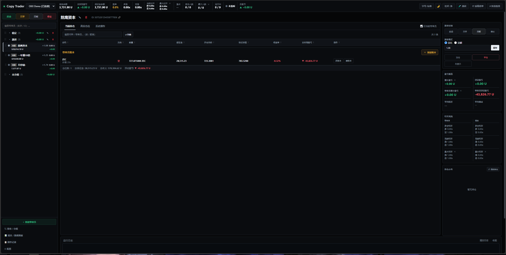
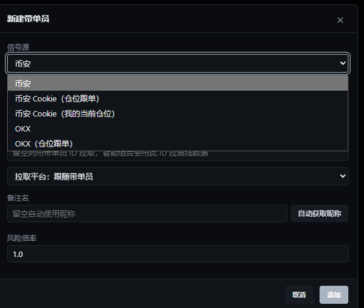

**English | [中文](README.md)**

# Copy Trader · Multi-Exchange Copy Trading System

> Local deployment · Multi-account · Multi-lead · Second-level sync · Full ledger · Runs on modest hardware

Copy Trader is a futures copy-trading system that runs on your own Windows machine. It watches a lead trader's fills or position changes in real time and mirrors them — open, add, reduce, close — into your own Binance, Gate, or OKX futures accounts at a multiplier you set. It ships with a full web dashboard, ledgers, statistics, and risk controls.

Everything runs locally. No cloud server to rent, no funds handed to any third party.

---

## 1. What it does

- **Copy trading** — pick a lead, set a multiplier, the program follows their entries and exits.
- **Multi-account** — manage several Binance / Gate / OKX accounts on one machine, each with independent copying and bookkeeping.
- **Multi-lead** — follow several leads at once, each with its own multiplier and start/stop state.
- **Multi-source** — Binance public fills, Binance cookie positions, OKX public fills, OKX positions.
- **Full ledger** — lead ledger, my ledger, history, real fills, operation log, latency stats. All retained, all reconcilable.
- **Web dashboard** — open from desktop or phone browser; live positions, PnL, margin, lead status, program log.
- **Risk controls** — latency threshold, duplicate-order guard, balance and min-size checks, auto-reconnect, single-instance lock.
- **Local data** — ledgers and config stay on your machine; data directory is switchable.

---

## 2. Five data sources and their latency

The program supports five lead data sources, selectable when adding a lead:

| Source | Basis | Typical latency |
| --- | --- | --- |
| **Binance** | Lead's public fill history | ~**2 min** |
| **Binance Cookie (position copy)** | Lead's current public position snapshot | ~**30 s** |
| **Binance Cookie (my positions)** | Your own Binance copy portfolio positions | ~**1 s** |
| **OKX** | Lead's public fills | ~**1 s** |
| **OKX (position copy)** | Lead's current public position snapshot | ~**1 s** |

Notes:

- Latency is "from the lead's action to the program noticing it". Actual values depend on network, exchange refresh cadence, and order type.
- **The ~2 min on Binance is Binance's own public-fill refresh cadence (risk-control / caching), not program lag — it cannot be bypassed.** For faster copying, use Binance Cookie position mode (~30 s) or OKX.
- Polling interval is configurable per source.
- Position-snapshot mode only establishes a baseline on first sight of a lead; it does not chase existing positions, so you never size an entry against a position that already ran.

---

## 3. Supported exchanges

| Role | Binance | Gate | OKX |
| --- | --- | --- | --- |
| Trading account (live) | ✅ | ✅ | ✅ |
| Trading account (demo) | ✅ | ✅ | ✅ |
| Lead data source | ✅ 3 types | — | ✅ 2 types |

In other words:

- You can copy into any one or several of Binance, Gate, OKX;
- Lead data comes from Binance and OKX;
- Gate provides no lead data source, but works fully as a trading account.

---

## 4. Features

### 4.1 Multiplier and capital allocation

Each lead has its own multiplier. Order size is derived as `margin ÷ participants ÷ lead balance × multiplier`, then converted to your account's quantity from the lead's actual fill size.

- Different multipliers per lead;
- Different multipliers per account for the same lead;
- One-click copy of a lead configuration to another account.

### 4.2 Four lead states

| State | Behavior |
| --- | --- |
| **Start** | Full copying: open, add, reduce, close |
| **Close-only** | Follow closes, no new entries |
| **Listen** | Receive and record data, no trading |
| **Stop** | Fully stop this lead |

Per-lead switching, plus all-start / all-close-only / all-listen / all-stop.

### 4.3 Order execution

- Follows open, add, reduce, close, and reverse (close then open);
- Proportional closes: closes the same fraction the lead closed;
- Cross-exchange copying: lead on Binance, you on Gate or OKX;
- Handles 10^n-prefixed symbols (`1000PEPE`, `1000SHIB`) contract-size conversion;
- Handles Gate tokenized stocks (e.g. `TQQQX`) and Gate 0.1-contract fractional sizing;
- Validates exchange min size, step, and balance before sending — never forces an invalid order.

### 4.4 Duplicate and consistency protection

- Every signal carries a unique ID; duplicates never double-order;
- Unfilled orders go to a pending queue and advance on real exchange state, not blind retry;
- Per-account serial execution lock prevents concurrent double-sizing;
- Restart restores from historical baseline; old fills are never re-copied;
- Single-instance lock per machine;
- Insufficient balance, rejects, and cancelled orders are never recorded as fills, so the ledger cannot invent positions.

### 4.5 Ledgers and reconciliation

- **Lead ledger** — per-symbol open/close records and current positions;
- **My ledger** — per-account, per-symbol position and average price;
- **History** — every copy: symbol, side, qty, price, time, latency;
- **Real fills** — pulled back from the exchange;
- **Operation log** — every manual or automatic action with its result and reason;
- **Latency stats** — real fill latency, max latency, skipped records.

History latency is `my fill time − lead fill time`, shown only when the two pair strictly. When they cannot be paired it shows `--`; it never pads with stale fills.

### 4.6 Manual operations

- Close a single position;
- Proportional close (selectable participation, all by default);
- Proportional add (rounded to step, auto-raised to min size);
- Close all;
- Set leverage;
- Sync / backfill lead positions;
- Manually clear a position record from the local ledger.

### 4.7 Portfolio optimizer and analytics

- **Smart combo** — genetic search over leads' historical equity curves for a better multiplier set;
- **Risk parity** — reallocate multipliers by volatility / risk contribution;
- **Stats** — per-lead returns, drawdown, win rate, copy contribution across periods;
- **Estimate** — backtest forward return and drawdown range at current multipliers;
- **Forecast** — compounding projection from historical distribution;
- Periods: 7D / 30D / 90D / 365D; return and drawdown scored 7:3.

> Smart combo and forecast are mathematical results over historical data. They do not guarantee future returns.

### 4.8 Real-time push and dashboard

- Private WebSocket push for positions, balances, and orders on Binance, Gate, OKX;
- Browser receives via SSE; no manual refresh;
- Falls back to 10 s REST polling when private WS drops, so manual closes are never missed;
- Tab title shows **unrealized PnL | margin balance** — glanceable from another tab;
- Mobile-adaptive; a phone on the same Wi-Fi works as a remote.

### 4.9 Network and proxy

- HTTP / SOCKS proxy support;
- Optional Clash node auto-switching: on consecutive failures it screens available nodes and verifies Binance, OKX, and Gate connectivity;
- Auto-reconnect; a network blip does not stop copying;
- Every fetch failure is written to the log and dashboard state — no silent signal loss.

### 4.10 Data safety

- All data in a local directory, backup or relocate at will;
- Config auto-restored from `.bak` if corrupted or missing;
- Atomic ledger writes; an abnormal exit cannot corrupt files;
- Destructive actions (remove lead, clear data) require confirmation.

---

## 5. Requirements

| Item | Requirement |
| --- | --- |
| OS | Windows 10 / 11, 64-bit |
| CPU | **2 cores** |
| RAM | **4 GB** |
| Disk | 1 GB+ recommended (ledgers grow with history) |
| Network | Stable broadband with access to Binance / OKX / Gate; proxy supported |
| Runtime | Program runs in background, dashboard in browser |

No GPU, no cloud server, no 24/7 datacenter. As long as the machine is on and online, copying continues.

---

## 6. Deployment

1. **Prepare a machine** — Windows 10/11, stays powered and online.
2. **Prepare exchange API keys** — create keys on Binance / Gate / OKX; enable **futures trading only**; **never enable withdrawals**; bind an IP whitelist.
3. **Install** — we handle local deployment, dependencies, and startup config.
4. **Open the dashboard** — `http://<machine-ip>:8550` (or `http://127.0.0.1:8550` locally).
5. **Add accounts** — enter API key / secret (OKX also needs passphrase).
6. **Add leads** — pick a source, enter the lead ID, set multiplier and initial state.
7. **Start copying** — switch the lead to Start.
8. **Monitor** — check positions, history, and logs; adjust multipliers or states as needed.

> For first use, run on a small balance or a demo account until accounts, multipliers, order sizes, and ledgers all reconcile, then scale up.

---

## 7. FAQ

**Q: Does the computer have to stay on?**
A: Yes. The program runs locally.

**Q: Do I need a server?**
A: No. Any Windows machine with 2 cores and 4 GB RAM is enough.

**Q: Can I view the dashboard on my phone?**
A: Yes, on the same LAN; the UI is mobile-adaptive. The program itself still runs on the PC.

**Q: Multiple leads and multiple accounts at once?**
A: Yes. Independent multipliers and states for each.

**Q: Can I copy Gate leads?**
A: Lead sources are Binance and OKX only; Gate works as your trading account.

**Q: Why is Binance ~2 minutes?**
A: Binance's public fill endpoint refreshes slowly (their risk-control / caching). The program can only poll at that cadence. Use Binance Cookie position mode (~30 s) or OKX (~1 s) for faster copying.

**Q: Will it double-order or double-size?**
A: Signal dedup, pending queue, per-account execution lock, position-cycle records, and restart baseline protection. Anomalies go to the operation log.

**Q: Can the program touch my funds or withdraw?**
A: It only trades futures through the API key you provide. Never enable withdrawal permission; bind an IP whitelist.

**Q: Where are ledgers and config stored?**
A: In a local data directory. Back up, migrate, or relocate freely. Nothing is uploaded.

**Q: Does the dashboard need a password?**
A: The current build targets single-user LAN use and has no login. Keep it on a trusted LAN; do not expose port 8550 to the internet.

---

## 8. Pricing

| Edition | Price | Difference |
| --- | --- | --- |
| **Standard** | **666 USDT** | Full feature set + local deployment + lifetime support |
| **Professional** | **1000 USDT** | Everything in Standard + custom development |

### Both editions include

- Full feature set: five data sources, multi-account, multi-lead, full ledgers, web dashboard, risk controls;
- One local deployment: we install, configure, and verify remotely;
- Lifetime support and maintenance: setup issues, exchange API changes, dependency upgrades, bug fixes.

### Professional adds

- **Custom development** — up to **10 feature requests**, implemented within the existing architecture, scheduled by complexity
  - Custom risk rules (per-symbol caps, intraday drawdown kill-switch, etc.)
  - Additional signal sources or data feeds
  - Dashboard layout or extra analytics dimensions
  - Other requests assessed case by case
- **Adoption reward** — if a requested feature is adopted into the Standard edition, **66 USDT per feature**

> All 10 adopted = up to 660 USDT back. Professional's net cost can be as low as 340 USDT, and those features stay in Standard for everyone.

### Notes

- Prices are one-time. Exchange fees, trading P&L, hardware, and network costs are not included;
- Requests beyond 10, or outside "within the existing architecture", are quoted separately;
- Adoption rewards are settled in USDT once the feature ships;
- No profit guarantee, no discretionary management, no access to your funds or withdrawal permission.

**Contact: Telegram [@gendancopy](https://t.me/gendancopy)**

---

## 9. Risk disclosure

Futures trading is highly leveraged and volatile. Copy trading does not guarantee profit; past performance does not indicate future results. A lead's strategy can lose money. The program only executes your configured copying and is not investment advice.

Only trade with capital you can afford to lose, and manage your own position sizing, leverage, and risk.

---

## 10. Contact

- Telegram: **[@gendancopy](https://t.me/gendancopy)**
- Project: Copy Trader · Multi-Exchange Copy Trading System
- Deployment: local (Windows)
