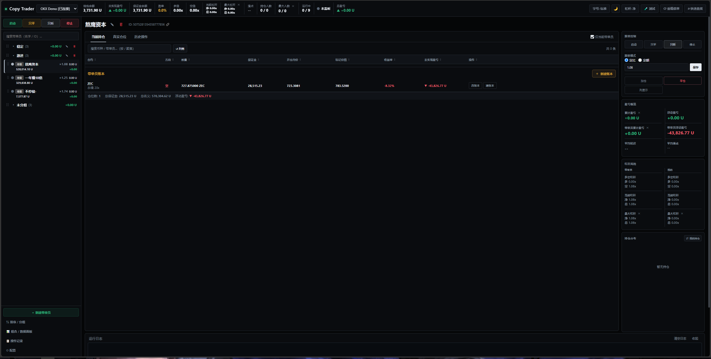
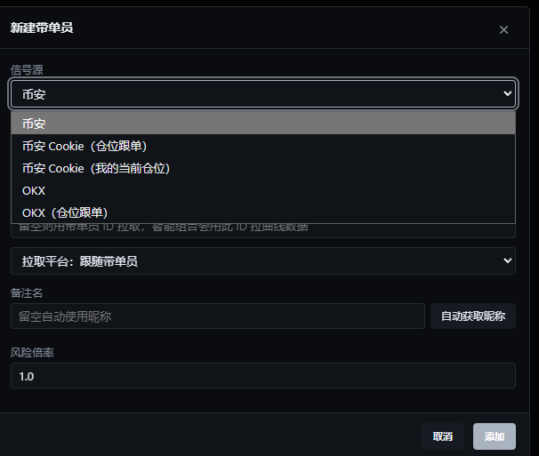

**[English](README.en.md) | 中文**

# Copy Trader · 多交易所跟单系统（币安跟单 / OKX 跟单 / Gate 跟单）

> 本地部署 · 多账户 · 多带单员 · 秒级推送 · 完整账本 · 低配可用

**Copy Trader 是一套多交易所合约跟单系统**，支持**币安跟单**、**OKX 跟单**、**Gate 跟单**，可在同一台 Windows 电脑上管理多个账户、同时跟随多个带单员。它实时监听带单员的成交或仓位变化，按你设定的倍率，在你自己的交易所合约账户里同步开仓、加仓、减仓和平仓，并提供完整的网页管理面板、账本、统计与风控。

**多账户跟单 · 份额闸门防超量平仓 · 跟单延迟实测 · 完整账本对账**——所有数据在本地，不需要租云服务器，也不需要把资金交给任何第三方平台。

---

## 一、这个程序能做什么

- **跟单**：选定带单员，设置倍率，程序自动跟着他开仓和平仓。
- **多账户**：同一台电脑可同时管理多个币安 / Gate / OKX 账户，各账户独立跟单、独立记账。
- **多带单员**：可同时跟多个带单员，每个人单独设置倍率、单独启停。
- **多数据源**：支持币安公开成交、币安 Cookie 仓位、OKX 公开成交、OKX 仓位等多种跟单方式。
- **完整账本**：带单员账本、我的账本、历史操作、真实成交、操作记录、延迟统计全部留档，可随时核对。
- **网页面板**：电脑和手机浏览器都能打开，实时查看持仓、盈亏、保证金、带单员状态和程序日志。
- **风控保护**：延迟门槛、防重复下单、余额与最小下单量校验、断线重连、双开保护。
- **本地数据**：账本和配置都保存在本机，可切换数据目录，不依赖云端。

---

## 二、五种带单员数据源与延迟

程序支持以下 5 种跟单数据源，可在添加带单员时选择：

| 数据源 | 跟单依据 | 典型延迟 |
| --- | --- | --- |
| **币安** | 带单员公开成交历史 | 约 **2 分钟** |
| **币安 Cookie（仓位跟单）** | 带单员当前公开仓位快照 | 约 **30 秒** |
| **币安 Cookie（我的当前仓位）** | 你自己币安跟单组合的当前仓位 | 约 **1 秒** |
| **OKX** | 带单员公开成交记录 | 约 **1 秒** |
| **OKX（仓位跟单）** | 带单员当前公开仓位快照 | 约 **1 秒** |

说明：

- 表中是“从带单员动作到程序发现”的典型时间，实际会受网络、交易所接口刷新和下单方式影响。
- **币安约 2 分钟是币安公开成交接口自身的刷新节奏（币安风控/缓存限制），不是程序卡顿，程序无法绕过。** 想更快可以选择币安 Cookie 仓位模式（约 30 秒）或 OKX。
- 每个数据源的轮询间隔都可以在配置里单独调整。
- 仓位快照模式第一次看到某个带单员时只建立基线，不追已有仓位，避免一上来就重仓跟进。

---

## 三、支持的交易所

| 用途 | 币安 | Gate | OKX |
| --- | --- | --- | --- |
| 作为交易账户（实盘） | ✅ | ✅ | ✅ |
| 作为交易账户（Demo 模拟） | ✅ | ✅ | ✅ |
| 作为带单员数据源 | ✅ 3 种 | — | ✅ 2 种 |

也就是说：

- 你可以用币安、Gate、OKX 任意一个或多个账户去跟单；
- 带单员数据目前来自币安和 OKX；
- Gate 暂不提供带单员数据源，但完全可以作为跟单交易账户。

---

## 四、主要功能

### 1. 倍率与资金分配

每个带单员可以单独设置倍率。程序按“保证金 ÷ 参与人数 ÷ 带单员余额 × 倍率”计算每个带单员分到的下单比例，再按带单员实际成交数量换算成你账户的下单量。

- 不同带单员可以给不同倍率；
- 同一带单员在不同账户也可以给不同倍率；
- 支持一键复制某个账户的带单员配置到另一个账户。

### 2. 四种带单员状态

每个带单员可以独立切换四种状态：

| 状态 | 行为 |
| --- | --- |
| **启动** | 正常跟单：开仓、加仓、减仓、平仓都跟 |
| **只平** | 只跟随平仓，不再开新仓 |
| **只听** | 只接收和记录数据，不交易 |
| **停止** | 完全停止该带单员 |

支持单个切换，也支持“全部启动 / 全部只平 / 全部只听 / 全部停止”。

### 3. 跟单执行

- 开仓、加仓、减仓、平仓、反手（先平后开）都会跟随；
- 按比例平仓：带单员平多少比例，你的仓位也平多少比例；
- 支持跨交易所跟单：带单员在币安，你在 Gate / OKX 也能跟；
- 自动处理 `1000PEPE`、`1000SHIB` 这类 10^n 前缀币种的面值换算；
- 支持 Gate 美股代币（如 `TQQQX`）及 Gate 0.1 张小数合约；
- 下单前校验交易所最小下单量、步进和余额，不合法就不硬下。

### 4. 防重复与一致性保护

- 每笔信号带唯一 ID，重复信号不会重复下单；
- 未完成订单进入 pending 队列，按交易所真实状态推进，不盲目重试；
- 账户级串行执行锁，防止同一账户并发下单造成双倍仓位；
- 程序重启后按历史基线恢复，不会把旧成交重新跟一遍；
- 双开保护：同一台电脑只能运行一个实例；
- 余额不足、拒单、废单不会被记成成交，避免账本凭空多出仓位。

### 5. 完整账本与对账

程序会在本地维护多套账本：

- **带单员账本**：带单员每个币种的开平仓记录与当前持仓；
- **我的账本**：你每个账户、每个币种的持仓与均价；
- **历史操作**：每一笔跟单的品种、方向、数量、价格、时间、延迟；
- **真实成交**：从交易所拉回的真实成交记录；
- **操作记录**：每一笔手动或自动操作的结果与原因；
- **延迟统计**：真实成交延迟、最大延迟、跳过记录。

历史操作里的延迟口径是“我方真实成交时间 − 带单员真实成交时间”，只在能严格配对时显示；配不上就显示 `--`，不会拿旧成交凑数。

### 6. 手动操作

除了自动跟单，面板还支持：

- 单仓平仓；
- 按比例平仓（可勾选参与仓位，默认全部）；
- 按比例加仓（按步进四舍五入，不足最小量自动上抬）；
- 全部平仓；
- 设置杠杆；
- 同步 / 补录带单员仓位；
- 手动清理本地账本中的某个仓位记录。

### 7. 智能组合与数据分析

内置数据面板，包含：

- **智能组合**：根据带单员的历史收益曲线，用遗传算法搜索一组更优的倍率组合；
- **风险平价**：按波动/风险贡献重新分配倍率；
- **统计**：每个带单员的多周期收益、回撤、胜率、跟单贡献；
- **预估**：按当前倍率回测未来收益与回撤区间；
- **预测**：基于历史分布做复利预测；
- 支持按周期（7D / 30D / 90D / 365D）查看，收益率与回撤按 7:3 加权评分。

> 智能组合和预测都是基于历史数据的数学结果，不保证未来收益。

### 8. 实时推送与面板

- 币安、Gate、OKX 私有 WebSocket 推送仓位、余额、订单变化；
- 网页通过 SSE 实时接收，不用手动刷新；
- 私有 WS 断开时自动回退到 10 秒 REST 轮询，不会漏掉手工平仓；
- 浏览器标签页标题直接显示**未实现盈亏 | 保证金余额**，看别的网页时也能瞄一眼；
- 面板自动适配手机，同一 Wi-Fi 下手机浏览器可直接当遥控器。

### 9. 网络与代理

- 支持 HTTP / SOCKS 代理；
- 可选 Clash 节点自动切换：程序发现连续请求失败时，会自动筛选可用节点并验证币安、OKX、Gate 连通性；
- 断线自动重连，不会因为一次网络抖动就停止跟单；
- 所有拉单失败都会写进日志和面板状态，不会静默丢信号。

### 10. 数据安全

- 所有数据保存在本机数据目录，可随时整体备份或切换目录；
- 配置文件损坏或丢失时自动从 `.bak` 恢复；
- 账本采用原子写入，程序异常退出不会写坏文件；
- 删除带单员、清空数据等危险操作都有二次确认。

---

## 五、运行要求

配置要求很低，普通办公电脑即可：

| 项目 | 要求 |
| --- | --- |
| 操作系统 | Windows 10 / 11 64 位 |
| CPU | **2 核**即可 |
| 内存 | **4 GB** 即可 |
| 硬盘 | 建议预留 1 GB 以上（账本会随交易记录增长） |
| 网络 | 稳定宽带，能访问币安 / OKX / Gate；需要时可用代理 |
| 运行方式 | 程序常驻后台，浏览器打开面板使用 |

不需要独立显卡，不需要云服务器，不需要 7×24 机房。只要电脑和网络保持在线，程序就能持续跟单。

---

## 六、部署与使用流程

1. **准备电脑**：一台 Windows 10/11 电脑，保持开机和联网。
2. **准备交易所 API**：
   - 在币安 / Gate / OKX 创建 API Key；
   - 只勾选“合约交易”权限；
   - **不要勾选提现权限**；
   - 建议绑定 IP 白名单。
3. **安装部署**：由我方完成本地部署、依赖安装和启动配置。
4. **打开面板**：浏览器访问 `http://本机IP:8550`（本机也可用 `http://127.0.0.1:8550`）。
5. **添加账户**：在面板里填入交易所 API Key / Secret（OKX 还需要 Passphrase）。
6. **添加带单员**：选择数据源，填入带单员 ID，设置倍率和初始状态。
7. **开始跟单**：把带单员切到“启动”，程序开始监听和同步下单。
8. **观察与调整**：在“当前持仓 / 历史操作 / 日志”里核对执行情况，按需调整倍率或状态。

> 首次使用建议先用小资金或 Demo 账户跑一段时间，确认账户、倍率、下单量和账本都对得上，再逐步加大资金。

---

## 七、常见问题

**Q：必须一直开着电脑吗？**
A：是。程序在本地运行。

**Q：需要租服务器吗？**
A：不需要。普通 Windows 电脑即可，4 GB 内存、2 核 CPU 就够用。

**Q：支持手机看面板吗？**
A：支持。手机和电脑在同一局域网时，用手机浏览器访问即可，界面会自动适配手机。程序本身仍需在电脑上运行。

**Q：能同时跟多个带单员、多个账户吗？**
A：可以。多个带单员、多个账户可以同时运行，各自独立设置倍率和状态。

**Q：能跟 Gate 的带单员吗？**
A：目前带单员数据源只支持币安和 OKX；Gate 可以作为你的交易账户使用。

**Q：币安为什么延迟约 2 分钟？**
A：币安公开成交接口本身刷新慢（受币安风控/缓存限制），程序只能按它的节奏拉取。想更快可以选择币安 Cookie 仓位模式（约 30 秒）或 OKX 数据源（约 1 秒）。

**Q：会不会重复下单、双倍仓位？**
A：程序有信号去重、pending 队列、账户执行锁、持仓周期记录和重启基线保护，正常使用不会重复下单。任何异常都会写进操作记录和日志。

**Q：程序会不会动我的资金、能不能提现？**
A：程序只通过你提供的 API Key 做合约交易，不碰提现。请务必只给交易权限、不给提现权限，并绑定 IP 白名单。

**Q：账本和配置存在哪里？**
A：全部保存在你本机的数据目录里，可整体备份、迁移或切换目录，不上传云端。

**Q：面板需要密码吗？**
A：当前版本面向单人内网使用，面板默认没有登录密码。请只在可信的局域网内使用，不要直接把 8550 端口暴露到公网。

---

## 八、价格与服务

| 版本 | 价格 | 区别 |
| --- | --- | --- |
| **标准版** | **666 USDT** | 全部功能 + 本地部署 + 永久售后 |
| **专业版** | **1000 USDT** | 标准版全部内容 + 客制化开发 |

### 两个版本都包含

- 全部功能：五种数据源、多账户、多带单员、完整账本、网页面板、风控保护
- 本地部署一次：我方远程安装、配置、跑通
- 永久售后与维护：安装配置问题、交易所接口变更、依赖升级、Bug 修复

### 专业版额外包含

- **客制化开发**：最多 **10 个功能需求**，在现有架构内实现，按复杂度排期
  - 自定义风控规则（单币种上限、日内最大回撤停机等）
  - 对接指定信号源或数据接口
  - 调整面板布局、增加统计维度
  - 其他需求可沟通评估
- **功能采纳奖励**：你提的需求如果被采纳进标准版，**每个奖励 66 USDT**

> 也就是说，10 个需求全部被采纳，最多可返 660 USDT——专业版实际成本最低 340 USDT，而且这些功能会长期留在标准版里给所有人用。

### 说明

- 价格均为一次性费用，不含交易所手续费、资金盈亏、电脑与网络费用
- 需求超出 10 个、或超出「现有架构内实现」范围的，按工作量另议
- 采纳奖励在功能上线后以 USDT 一次性结算
- 不承诺收益，不代客理财，不接触你的资金和提现权限

**联系：Telegram：[@gendancopy](https://t.me/gendancopy)**

---

## 九、风险提示

合约交易具有高杠杆、高波动风险，跟单不代表稳赚，历史业绩不代表未来收益。带单员的策略可能亏损，程序只负责按你的设置执行跟单，不构成任何投资建议。

请只用你能够承受亏损的资金参与，并自行做好仓位、杠杆和风险控制。

---

## 十、联系

- Telegram：**[@gendancopy](https://t.me/gendancopy)**
- 项目：Copy Trader · 多交易所跟单系统
- 部署方式：本地部署（Windows）
